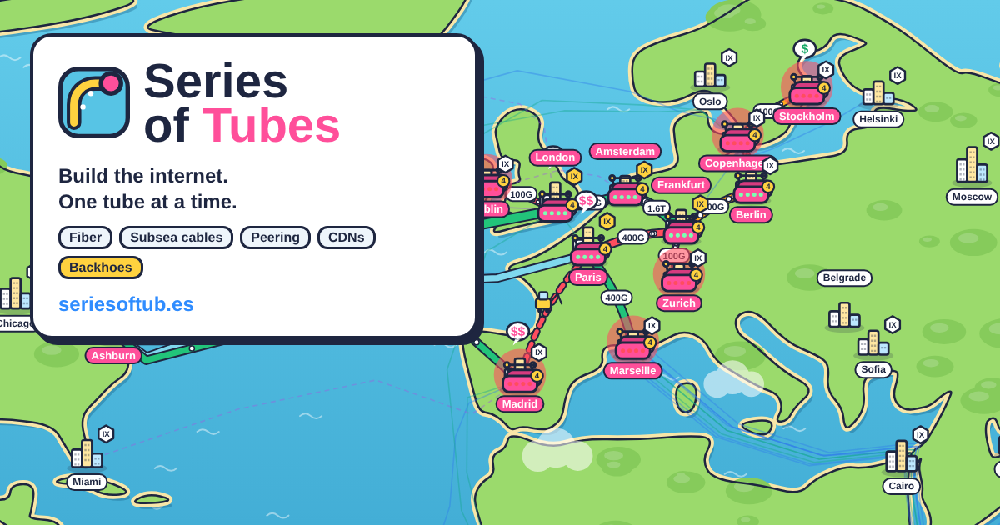

# Series of Tubes 2.0

Форк мультяшной браузерной игры [Series of Tubes](https://github.com/fjaeckel/seriesoftubes)
от Frederic Jung: строишь свою сеть, покупаешь транзит, пиришься на IX, тянешь оптику и
подводные кабели и выживаешь под экскаваторами, акулами и утечками маршрутов.

В 2.0 игра **полностью переведена на русский**, на карте появились **Казахстан, Сибирь,
Дальний Восток и новые города Украины**, а сети носят **настоящие названия** и настоящие номера AS.

## Как запустить

```bash
npm ci          # один раз: jsdom для тестов
npm run serve   # собрать и открыть локально
```

Или просто открой `site/index.html` в браузере. Язык выбирается на титульном экране
или в настройках: **English / Italiano / Русский**. Если в браузере стоит русский, игра
сама откроется на русском.

## Что сделано

### Русский язык
- `site/i18n/ru.js`: перевод всех 2443 строк игры, от кнопок и подсказок до шуток,
  сценариев, банков и инцидентов. Сохранены все `{плейсхолдеры}` и HTML-теги.
- Настоящие русские множественные формы: «1 линк / 2 линка / 5 линков». Перевод
  хранит три формы через `|`, а `trn()` выбирает нужную через `Intl.PluralRules`.
  `scripts/i18n-check.js` проверяет каждую форму отдельно.
- Названия городов переводятся (Франкфурт, Москва, Алматы…). В итальянском словаре
  они тоже есть.
- У шрифта заголовков Baloo 2 нет кириллицы, поэтому для неё подключён Nunito.
- Сервис-воркер кэширует `ru.js` для офлайн-режима.

### Новые города (15)
| Регион | Города |
| --- | --- |
| Казахстан | Алматы, Астана, Шымкент, Караганда, Актобе, Павлодар, Атырау, Усть-Каменогорск |
| Россия | Новосибирск, Самара, Белгород, Горно-Алтайск, Владивосток |
| Украина | Ужгород, Кривой Рог |

- В новых российских городах действуют те же правила, что и в Москве: госкоробка
  в каждом POP, замедление видео Google, учения «суверенного интернета».
- В Ужгороде и Кривом Роге, как в Киеве, бывают блэкауты.
- Ёмкость между Украиной и Россией не продаётся ни из какого города.
- Подводный кабель Владивосток–Токио.

### Новые IX
- **KAZ-GOV-IX** в Алматы и Астане, **KAZ-IX** в Караганде.
- **MSK-IX** в Новосибирске, Самаре и Владивостоке.
- **GNM-IX** в Амстердаме, где больше половины участников из России.

### Новые провайдеры (23, номера AS сверены с RIPE)
- **Казахстан:** Kazakhtelecom AS9198, Kar-Tel (Beeline KZ) AS21299, Jusan Mobile AS35104
  (теперь Qmobile), Transtelecom KZ AS41798.
- **Евразия:** RETN AS9002, с маршрутом TRANSKZ из Европы через Казахстан в Гонконг.
- **Россия:** MTS AS8359, Beeline AS3216, MegaFon AS31133, TransTeleCom AS20485,
  ER-Telecom (Dom.ru) AS9049, Novotelecom AS31200.
- **Украина:** Ukrtelecom AS6849, Datagroup-Volia AS21219, Lanet AS39608,
  lifecell AS34058, Vodafone Ukraine AS21497.
- **Польша:** Orange Polska AS5617, Netia AS12741, Play AS39603, T-Mobile Polska AS12912.
- **Великобритания:** Hyperoptic AS56478.
- **Германия:** Vodafone Germany AS3209, O2 Telefónica AS6805, 1&1 Versatel AS8881.

### Настоящие названия вместо пародий
В оригинале все сети были пародиями (Cogentle, Goggle, NetChill, Rostelecomedy…).
В 2.0 у всех 73 сетей настоящие имена и настоящие номера AS: Cogent AS174,
Google AS15169, Netflix AS2906, Lumen AS3356, Rostelecom AS12389, Kyivstar AS15895 и т.д.
Кэши CDN тоже настоящие: Open Connect, Google Global Cache, Meta FNA, Akamai AANP.
Описания, где шутка строилась на пародийном имени, переписаны в нейтральном тоне.

Названия IX в городах, подводных кабелей, производителей роутеров и банков
пока остались пародийными.

### Тесты
Все 131 тест проходят (`npm test`). Добавлены тесты на русские множественные формы,
полный прогон игры на русском и новые регионы.

## Лицензия
MIT, как у оригинала. Оригинальная игра © 2026 Frederic Jung,
[github.com/fjaeckel/seriesoftubes](https://github.com/fjaeckel/seriesoftubes).

---

*Ниже оригинальное описание проекта (на английском).*

# Series of Tubes

**Build the internet, one tube at a time.** A free cartoon browser game about how
the internet really works. Play it at **[seriesoftub.es](https://seriesoftub.es)**.



You start with one router in one city and grow into a transit-free Tier 1:

- **Customers:** home broadband ("eyeballs"), enterprises, hosting, L2VPNs, DDoS
  protection, high-frequency traders with latency budgets, AI GPU data centers and
  hyperscaler DCI deals. Some come with very specific requirements.
- **Interconnection:** IP transit billed on the 95th percentile, internet exchanges
  with route servers, open/selective/restrictive/paid peering, PNIs, embedded CDN
  caches, and NNI fabrics for virtual circuits and remote peering.
- **Infrastructure:** leased waves on around 40 subsea cable systems modelled on real ones,
  dark fiber (leased or self-built) lit with DWDM and ZR+ optics, router
  generations that cap your port speeds, and LAGs to bundle ports when one isn't enough.
- **Traffic engineering:** see exactly what fills each link, tune link metrics and
  egress preferences, and route traders over the fastest path and backups the scenic way.
- **Things break, constantly:** backhoes, sharks, fat fingers, route leaks, RPKI
  mishaps, DDoS, cooling failures, Red Sea and Baltic cable cuts, sanctions and
  sovereign internet drills.

In the original every company is a pun. In 2.0 networks use their real names (see above).

## Learn how it really works

This game simplifies a lot, and gets some things gloriously wrong on purpose. For
the real thing, go to **[How the Internet Works](https://tkjaer.github.io/how-the-internet-works/)**
by Thomas Kjær Aabo ([source](https://github.com/tkjaer/how-the-internet-works)):
an interactive, zoomable map that follows your data from Wi-Fi and copper to
undersea fiber, as the internet works today, in 2010 and in 1995, with simple or
technical explanations. If you enjoy Series of Tubes, you will learn more from
an hour there than from a year of laying cartoon fiber here.

## Playing locally

It is a single static page with no build step for development:

```sh
open site/index.html          # or: npm run serve
```

Progress is saved in your browser's local storage.

The game speaks English and Italian. It follows your browser's language the first time
and remembers the one you pick under Settings or on the title screen.

## Development

```sh
npm ci
npm test       # headless tests: boot, geography, a year of play, every incident, every panel
npm run build  # writes the deployable site to _site/ with version and date stamped in
npm run i18n:check  # lists text missing from (or stale in) the translations
```

```
site/                  everything that is deployed
  index.html           the whole game (HTML, CSS and JS in one file)
  i18n/it.js, ru.js    Italian and Russian translations, loaded only when the game runs in that language
  images/og-image.png  social preview (1200×630)
  favicon.*, icon-*    favicons, app icons, manifest
  robots.txt, sitemap.xml, llms.txt, 404.html, CNAME
scripts/build.sh       copies site/ to _site/ and stamps __VERSION__ / __BUILD_DATE__
tests/                 node:test + jsdom
.github/workflows/     ci.yml (pushes to main and PRs) and release.yml (Pages deploy)
```

## Translations

English is the source text. Player-facing strings in `index.html` go through
`tr('Unlocks at level {n}.', {n})` (or `trn(one, other, n)` for plurals); static markup
uses `data-i18n`, and `aria-label`/`title` are translated at boot. Each language is a
`site/i18n/<lang>.js` file mapping the English text to its translation, plus an entry in
`SOT_LANGS` (the language loader at the top of the page). Missing entries fall back to
English, so new English text never breaks the game. Languages with more than two plural
forms (Russian) store them as `"one|few|many"` under the plural key and `trn()` picks one with
`Intl.PluralRules`; `npm run i18n:check` lists what
needs translating, and the tests make sure every translation keeps its `{placeholders}`
and HTML tags.

## Releasing

Only published releases reach [seriesoftub.es](https://seriesoftub.es). Ordinary
pushes to `main` run CI and nothing else; a version bump is the release button.

1. Bump `version` in `package.json` (semver) and rename the changelog's
   `[Unreleased]` section to `## [<version>] — <date>`. Write the bullets for
   players: the build turns that section into the in-game "What's new" card and
   into `/version.json`, which open games poll to offer a reload.
2. Push or merge to `main`.

The **Auto-release** workflow then runs the tests, tags `v<version>`, publishes a
GitHub release with that changelog section as notes, and starts the deploy. It
does nothing when the tag already exists, and refuses a version older than the
latest release or one without changelog notes. A version with a pre-release
suffix (`1.2.0-beta.1`) becomes a pre-release and is not deployed. You can still
publish a release by hand; the deploy runs the same way.

The release workflow checks that the tag matches `package.json`, runs the tests,
builds, deploys to GitHub Pages and pings IndexNow. It refuses to build when the
CHANGELOG has no `## [<version>]` section (rename `[Unreleased]` first).
Pre-releases never deploy, also not when run by hand, and a version older than
the live one is refused unless you tick `allow_older` (a deliberate rollback).
To redeploy an existing release, run the workflow manually with its tag.

## Hosting setup

GitHub Pages serves the site with **Source: GitHub Actions** and the custom domain
`seriesoftub.es`. Releases deploy from tags, so in **Settings → Environments →
github-pages → Deployment branches and tags**, add a tag rule for `v*` (by default
only the default branch may deploy). DNS for the apex domain:

```
seriesoftub.es.        A     185.199.108.153
seriesoftub.es.        A     185.199.109.153
seriesoftub.es.        A     185.199.110.153
seriesoftub.es.        A     185.199.111.153
seriesoftub.es.        AAAA  2606:50c0:8000::153
seriesoftub.es.        AAAA  2606:50c0:8001::153
seriesoftub.es.        AAAA  2606:50c0:8002::153
seriesoftub.es.        AAAA  2606:50c0:8003::153
www.seriesoftub.es.    CNAME fjaeckel.github.io.
stats.seriesoftub.es.  CNAME seocho.jc-ix.net.
```

Once DNS resolves, enable **Enforce HTTPS** in the repository's Pages settings.

## Analytics

The game uses [Ridiculytics](https://github.com/fjaeckel/ridiculytics): cookieless,
no persistent identifiers, self-hosted at `stats.seriesoftub.es`. It only reports
from `seriesoftub.es` itself; local copies, previews and forks stay silent. The
script is pinned to `ridiculytics@1.0.1` with an SRI hash.

Besides page views and session length, the game sends a few coarse events, all
under the collector's 50-name cap: `game_new`, `game_continue`, `play_1m` …
`play_120m` (active, unpaused play time), `goal_<id>`, `level_2`–`level_4`,
`game_year_2/3/5`, `win_tier1` and `bankrupt`.

The collector must allow the site, e.g. in `sites.yaml`:

```yaml
sites:
  - domain: seriesoftub.es
    origins: ["https://seriesoftub.es", "https://www.seriesoftub.es"]
```

## Contributing

Issues and pull requests are welcome. See [CONTRIBUTING.md](CONTRIBUTING.md).

## License

[MIT](LICENSE) © 2026 Frederic Jung
